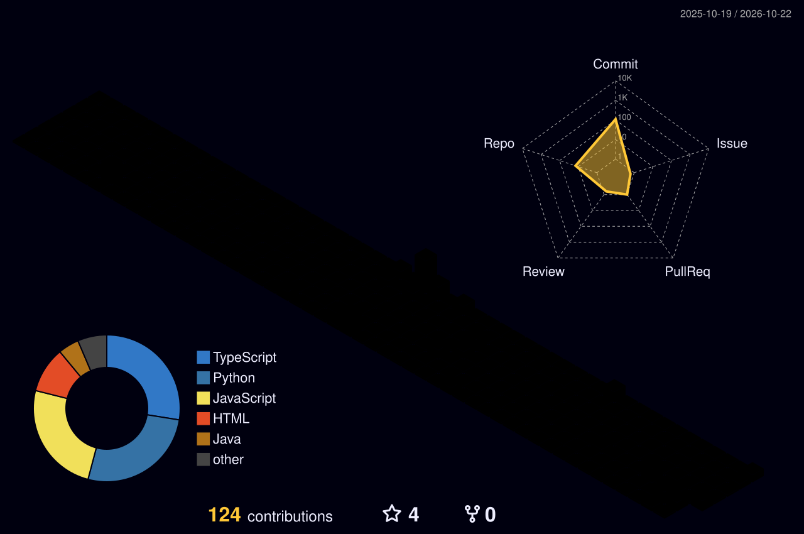

# Hi 👋, I'm Shivam

### Aspiring Product Manager | AI & Technology Enthusiast

Turning user problems into thoughtful, AI-powered product experiences by combining user research, product strategy and hands-on technical execution.

📍 India · ✉️ [gptshivam595@gmail.com](mailto:gptshivam595@gmail.com) · 🟢 Open to opportunities

---

## Connect with me

> “Build with purpose. Learn through experiments. Make products people love.”

---

## Languages and Tools

<table>
<tr>
<td align="center" width="80"> Java</td>
<td align="center" width="80"> Python</td>
<td align="center" width="80"> JavaScript</td>
<td align="center" width="80"> TypeScript</td>
<td align="center" width="80"> React</td>
<td align="center" width="80"> Spring Boot</td>
</tr>
<tr>
<td align="center"> MySQL</td>
<td align="center"> HTML</td>
<td align="center"> CSS</td>
<td align="center"> Git</td>
<td align="center"> Docker</td>
<td align="center"> Postman</td>
</tr>
</table>

---

## Featured Projects

<a href="https://github.com/gptshivam595?tab=repositories">View all repositories →</a>

<table>
<tr>
<td width="50%" valign="top">

### VisualEval Multi-Agent

AI-powered evaluation of generated fashion images through multiple Indian personas.

[View Project →](https://github.com/gptshivam595/VisualEval-MultiAgent)

</td>
<td width="50%" valign="top">

### AI B2C Lead Intelligence

Transforms messy B2C lead data into structured, prioritized sales insights.

[View Project →](https://github.com/gptshivam595/AI-b2c-lead-intelligence)

</td>
</tr>
<tr>
<td width="50%" valign="top">

### Customer Feedback Analysis

AI-assisted tool for turning customer feedback into actionable insights.

[View Project →](https://github.com/gptshivam595/Customer-feedback-analysis-tool)

</td>
<td width="50%" valign="top">

### Clinical Staff Scheduling

Scheduling application exploring workflow organization and operational efficiency.

[View Project →](https://github.com/gptshivam595/clinical-staff-scheduling-compliance)

</td>
</tr>
</table>

---

## GitHub at a Glance

<table>
<tr>
<td></td>
<td></td>
<td></td>
</tr>
</table>

---

## 🧊 My 3D Contribution Landscape

<!-- Animated SVG. Appears after the profile-3d workflow runs once. -->

  

---

<table>
<tr>
<td align="center" width="25%"><b>Product Mindset</b> Understand the problem</td>
<td align="center" width="25%"><b>Build & Prototype</b> Turn ideas into solutions</td>
<td align="center" width="25%"><b>Measure & Learn</b> Use data to improve</td>
<td align="center" width="25%"><b>Create Impact</b> Build for a better tomorrow</td>
</tr>
</table>
